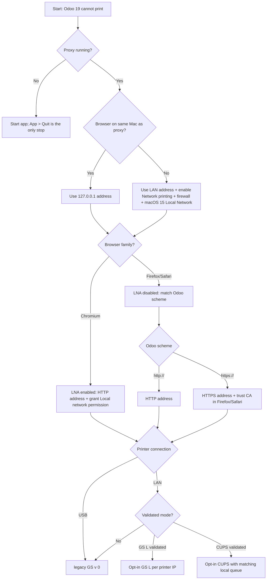

# Printing modes, benchmark and rollout — Epson TM-T88 + Odoo 19 on macOS

**Status:** draft for technical review · **Updated:** 2026-11-16 · **Scope:** Obox-app
(ePOS Proxy) and Odoo 19 on macOS 10.15–26 with Epson TM-T88 IV, V, VI and VII.

This is the canonical reference for **choosing a printing mode, preparing a
benchmark, trusting the local CA in Firefox, and rolling back**. It consolidates
the accepted browser/CA guide, the benchmark protocol of PR #5 and the retry
analysis of PR #6. It does **not** certify compatibility: no physical benchmark
has been recorded yet (see [§5](#5-benchmark-results)).

Do not maintain parallel copies of this procedure. Update this document and let
the guides link to it.

## 1. Evidence levels

Every non-obvious statement is marked:

| Mark | Meaning |
|---|---|
| **[C]** | Verified in repository code, a build workflow, or pinned Odoo 19.0 sources. |
| **[M]** | Modelled from verified sources, not observed in a real browser/printer. |
| **[F]** | Physical validation pending. No paper, cut, duplicate or browser run exists. |
| **[S]** | No evidence available. Nothing is claimed. |

A unit test proves the model, not the printer. A passing CI run proves code
compiles, not that a receipt printed.

## 2. What the code does today (`main`, `5d571a0`)

- The proxy listens on HTTP `4545–4555` and HTTPS `4645–4655`, one port per
  printer slot **[C]** (`internal/config/config.go`).
- Odoo receives a protocol-free `host:port/p/<printer-id>` address and builds
  the URL itself **[C]**.
- USB and LAN printers are written directly with ESC/POS. Raster receipts use
  `GS v 0`; there is no mode selector on `main` **[C]**
  (`internal/escpos/commands.go`).
- Raster images are sliced at **2048 rows** and USB writes are chunked at
  **64 KiB** (`12eed02`, `5d571a0`). Neither change has a physical benchmark
  **[C] change, [F] effect**.
- Image selection and CUPS exist **only in draft PRs**, both opt-in and neither
  physically validated:
  - **PR #3** (`fix/lan-raster-ci-and-streaming-20261104`, `9345411`): per-IP
    LAN image mode with Epson `GS ( L` (fn 112 store / fn 50 print) and a
    legacy default **[C]**.
  - **PR #4** (`feat/cups-driver-receipts-20261105`, `06033ab`): opt-in macOS
    LAN mode that submits a 1-bit PNG to an existing Epson CUPS queue
    **[C]**, stacked on PR #3.
- Non-loopback clients are rejected unless **Network printing** is enabled in
  the app **[C]** (`internal/server/server.go`, `AccessPolicy.remoteAllowed`).
- The local CA lives in `~/Library/Application Support/EposProxy/certs/`; the
  server certificate is reissued for current LAN IPs, the CA is never rotated
  automatically **[C]** (`internal/certs/certs.go`, `docs/macos11-odoo-https.md`).

### 2.1 Supported build targets (not runtime certification)

| Artefact | Deployment target | Go | CI runner |
|---|---|---|---|
| Intel `darwin/amd64` | macOS 10.15 | 1.22.12 | `macos-15-intel` |
| Apple Silicon `darwin/arm64` | macOS 11.0 | 1.24.13 | `macos-15` |

These are build constraints from `.github/workflows/build-macos.yml`
**[C]**. A macOS 15 runner does not exercise Catalina or macOS 26; no version in
10.15–26 has been executed for printing **[F]**.

## 3. Benchmark methodology

The full protocol is `docs/printing-benchmark.md`, delivered by **PR #5**
(`5137bc5`). Summary:

- **Tickets:** short (text), medium (text + QR/barcode), long (> 297 mm). Freeze
  each body as a file and record its SHA-256.
- **Repetitions:** 20 per scenario, cold start and warm start separately. Do not
  mix them in one percentile set.
- **Modes:** `legacy` (USB/LAN), `gs_l` (LAN, PR #3 build), `cups` (LAN, PR #4
  build with a queue installed). Compare only like with like: never a USB legacy
  run against a LAN CUPS run.
- **Metrics, never merged into one number:**

| Metric | Source |
|---|---|
| HTTP response (`total_ms`) | `print_trace` line |
| body / parse / enqueue / open / write / close | `print_trace` line |
| first paper, cut | video at 60 fps or two stopwatches |
| errors and ePOS codes | `status`, `code`, `error` |
| duplicates | physical receipt count |
| `xmlBytes`, `escposBytes`, `raster_w`, `raster_h`, `write_blocks` | `print_trace` line |

- **Statistics:** p50, p95, min, max with nearest-rank; report `n` and all
  failures. Fewer than 20 samples is an anecdote, not a p95.
- **Trace line:** one per ticket at `info` level, correlated by `request_id`,
  without receipt content or credentials. Pull it from
  `~/Library/Application Support/EposProxy/logs/epos-proxy.log`.
- **Paper is not observable from the proxy.** A ticket that answers in 40 ms and
  cuts after 2 s is a firmware/transport problem, not a proxy problem; only the
  separated measurements show that.

No improvement target is defined here. Thresholds belong to whoever owns the
baseline, once it exists.

## 4. Benchmark scenarios to run

| Id | Mode | Transport | Build | Status |
|---|---|---|---|---|
| S1 | `legacy` | USB | `main` | **[F]** not run |
| S2 | `legacy` | LAN | `main` | **[F]** not run |
| S3 | `gs_l` | LAN | PR #3 | **[F]** not run |
| S4 | `cups` | LAN (local queue) | PR #4 | **[F]** not run |

Each scenario is measured on t1/t2/t3, cold and warm: 4 modes × 3 tickets ×
2 starts × 20 repetitions. The only indirect data point on record is a ~30 ms
TCP write for a 138–146 KB receipt mentioned in the PR #4 analysis **[M] n=1**;
it is not a benchmark and must not be quoted as a result.

## 5. Benchmark results

**No physical measurement has been recorded for any mode.** The table is the
fixed format the owner of the baseline must fill; empty cells are pending, not
zero.

| Scenario | n | errors | duplicates | p50 HTTP | p95 HTTP | p50 write | p50 first paper | p50 cut | xmlBytes | escposBytes | raster |
|---|---|---|---|---|---|---|---|---|---|---|---|
| S1 legacy USB t1/t2/t3 | — | — | — | — | — | — | — | — | — | — | — |
| S2 legacy LAN t1/t2/t3 | — | — | — | — | — | — | — | — | — | — | — |
| S3 GS ( L LAN t1/t2/t3 | — | — | — | — | — | — | — | — | — | — | — |
| S4 CUPS LAN t1/t2/t3 | — | — | — | — | — | — | — | — | — | — | — |

Until this table is filled with raw logs attached, any statement such as "CUPS is
faster" or "GS ( L fixes slow tickets" is **unsupported**.

## 6. Decision tree

### 6.1 Rules, in order

**R1 — Terminal and build.** The proxy must be running on the Mac (closing the
window does not quit; **App → Quit** does). Intel needs macOS 10.15+, Apple
Silicon needs 11.0+ to launch the artefact **[C]**. Choose the artefact that
matches the chip.

**R2 — Where is the POS browser?**

- Same Mac as the proxy → use a **loopback** address (`127.0.0.1`). Loopback
  avoids LAN routing, the firewall and macOS 15+ Local Network privacy **[C]**.
- Another device → use a **LAN** address, enable **Network printing**, allow
  incoming connections for ePOS Proxy in the macOS firewall, and on macOS 15+
  allow Local Network for both the browser and the proxy **[C]**.

**R3 — Browser family.**

- **Chromium (Chrome/Edge):** Local Network Access exists in current Chromium
  (Chrome 142 reference **[M]**). Keep `point_of_sale.use_lna` enabled, use the
  HTTP address, and grant the Odoo origin the *Local network* permission. If LNA
  is unavailable or denied, Odoo falls back to the page scheme: on an `https://`
  Odoo use the HTTPS address and trust the CA in the macOS Keychain.
- **Firefox and Safari:** LNA is not implemented. Odoo's permission query throws,
  `odoo.use_lna` becomes `false`, and the **Odoo page scheme** decides the URL
  **[C]**. Disable `point_of_sale.use_lna` before loading the POS, then match the
  scheme (R4).

**R4 — Odoo scheme → address.**

| Odoo page | Address to copy | Additional requirement |
|---|---|---|
| `http://` | HTTP (local or LAN) | none |
| `https://` | HTTPS (local or LAN) | CA trusted **in that browser**; certificate SAN must cover the host used |

Never prefix the address with `http://` or `https://` in Odoo: Odoo builds the
URL itself. The URL is fixed when the POS loads; after changing the parameter or
the address, save and **reload the POS** **[C]**.

**R5 — Firefox/Safari on an `https://` Odoo.** Trust `epos-proxy-ca.crt` in
Firefox's own NSS store (see [§8](#8-firefox-and-the-local-ca)). Safari uses the
Keychain. Verify by opening the HTTPS **base** address (no `/p/<id>`): it must
return `status: ok` without a warning. A local `curl`/`openssl` check does not
prove a remote browser profile trusts it **[C]**.

**R6 — Printing mode.**

- **USB printer → legacy.** GS ( L and the CUPS route are LAN-only **[C]**.
- **LAN printer → legacy by default.** GS ( L or CUPS only after the conditions
  in [§7](#7-mode-selection) and a physical validation; an unknown model stays
  on legacy **[C]**.

**R7 — macOS 15+.** Allow **Local Network** for ePOS Proxy (its outgoing
connections to the printer) and for the browser when it targets a LAN address.
This is separate from incoming access, which the Application Firewall controls
**[C]**.

### 6.2 Diagram

## 7. Mode selection

| Mode | Applies to | Build | Requirements | Risks | Evidence |
|---|---|---|---|---|---|
| **Legacy `GS v 0`** | USB and LAN receipt printers | `main` | none | 2048-row slices and 64 KiB USB chunks unbenchmarked; some firmware may prefer 255 rows | **[C]** default, **[F]** performance |
| **Epson `GS ( L`** | LAN receipt printers only, per printer IP | PR #3 | Model confirmed as TM-T88 IV–VII; opt-in in the app; physical test on that exact unit | `GS ( L` fn 112/50 not verified on V–VII; TCP acceptance ≠ printing; never auto-fall-back (duplicate risk) | **[C]** code/CI, **[F]** physical |
| **macOS CUPS** | macOS + LAN + local queue | PR #4 | Existing Epson queue whose device URI is `socket://<printer-ip>:9100`; queue named in the app; driver/PPD/options identified per queue | Profile is 180 DPI + `Tmt*` from a **IV** queue, not universal; custom media > 297 mm may be rejected/rescaled; `lp` accepted ≠ paper; no auto retry | **[C]** code/CI, **[F]** physical |

Rules that apply to both experimental modes:

- They are **opt-in per printer IP**. The safe default remains **Compatible
  (GS v 0)**; unidentified models do not change behaviour **[C]**.
- A successful TCP write or `lp` exit code proves acceptance by the transport or
  CUPS, **not** that the printer understood the data or produced a cut receipt
  **[C]**.
- Do not configure automatic fallback from one mode to another: a second copy of
  the same ticket is worse than a failed one.

## 8. Firefox and the local CA

Firefox keeps its own certificate authorities. Sample properties verified in
DS-4: `security.enterprise_roots.enabled` is `false` in 115 ESR and `true` in
120, 128 ESR, 140, 145 and 146 **[C]**. Versions not sampled are **[S]**.

**Order of operations**

1. Get the **real URL** Odoo calls from the browser **Network** tab. Do not
   reconstruct it from `window.odoo.use_lna`; the URL was built at POS load and
   may not reflect the current value **[C]**.
2. Only if that URL is `https://`, trust the CA. Path:
   `~/Library/Application Support/EposProxy/certs/epos-proxy-ca.crt`.
3. Firefox 120+ with enterprise roots on: mark **ePOS Proxy Local CA** *Always
   Trust* in Keychain Access, quit Firefox completely and reopen **[C]**.
4. 115 ESR, enterprise roots disabled, or CA not *Always Trust*: **Settings →
   Privacy & Security → Certificates → View Certificates… → Authorities →
   Import…**, choose the `.crt`, tick **Trust this CA to identify websites**,
   accept, restart Firefox **[C]**.
5. Verify with the HTTPS base address, typed explicitly with `https://`
   (`https://127.0.0.1:4645/` when the browser and proxy share the Mac, or
   `https://<proxy-host>:4645/` otherwise). It must return JSON with
   `"status":"ok"` and no warning. Check that the SAN covers the host you used.
6. Safari uses the Keychain; the Firefox import is not needed there **[M]**.

**Error → cause** (do not treat any message as a single-cause diagnosis):

| Message | Most likely cause |
|---|---|
| `SEC_ERROR_UNKNOWN_ISSUER` | HTTPS URL, CA not trusted in this Firefox profile |
| `SSL_ERROR_RX_RECORD_TOO_LONG` | TLS sent to the HTTP port; address scheme ≠ Odoo scheme |
| Blocked mixed active content | `https://` Odoo + `http://` LAN address + no effective LNA |
| Connection reset / HTTP 400 on an `http://` page | Plain HTTP sent to the TLS port |
| "printer not reachable" after ~15 s | Odoo's `AbortSignal.timeout(15000)`; groups latency, network, CORS and mixed content |

The local CA is never installed silently; every trust change is a visible
action in Keychain or in Firefox **[C]**.

## 9. CUPS requirements and activation

The app **does not install drivers or create queues**. A CUPS run exists only on
a Mac where the queue already exists and its owner authorised its use.

**Requirements**

- macOS, LAN printer only (the CUPS route does not cover USB, IPP/AirPrint or a
  remote print server) **[C]**.
- A queue whose device URI is `socket://<printer-ip>:9100`, matching the
  configured printer IP. The app lists only queues whose socket IP matches
  **[C]**.
- Record before testing: `lpstat -v`, `lpoptions -p <queue> -l`, queue name,
  driver/PPD and package version, printer model and firmware **[C]** commands,
  **[F]** values.
- The PR #4 profile (`180x180dpi`, `Resolution`, options starting `Tmt*`,
  `RP80x297`, `Custom.80x…`) comes from a **TM-T88 IV** queue cited in code
  comments. It is **not** the universal Epson default and does not prove
  equivalence on V–VII **[C]**. If the real queue differs, propose a specific
  configuration for that queue or explicitly reject it; never apply the IV
  profile silently.

**Activation (only after physical validation)**

1. Enable network printing for the LAN printer and confirm the direct path
   works first.
2. Select **Epson system driver (macOS CUPS)** for that printer IP and pick the
   matching queue.
3. Print the same Odoo ticket on legacy and on CUPS: compare response, first
   paper and cut; verify QR/barcode 10/10, cut and drawer 20/20, and a > 297 mm
   ticket end-to-end.
4. On any CUPS error, confirm no automatic resend and no duplicate, and return
   to Compatible.

## 10. Rollback

All rollbacks below are local, reversible and require no reinstall unless stated.

| Change | Rollback | Verify |
|---|---|---|
| GS ( L or CUPS per printer | Select **Compatible (GS v 0)** for that printer IP, or stop the app, remove the IP from `lan_image_modes`/`lan_cups_queues` in `~/Library/Application Support/EposProxy/config.json`, and start it | A test ticket prints; `lpstat -o <queue>` shows no job submitted by this ticket |
| CUPS queue itself | `lpadmin -x <queue>` (admin; only with owner authorisation) | `lpstat -v` no longer lists the queue |
| Address/scheme | Copy the other address (HTTP ↔ HTTPS, loopback ↔ LAN) and **reload the POS** | Network tab shows the expected URL; base address returns `status: ok` |
| Remote access | Disable **Network printing** | Non-loopback clients receive 403 again |
| Firefox CA | Settings → Certificates → Authorities → select the ePOS CA → delete or edit trust; restart Firefox. Delete the CA from Keychain to undo system trust | HTTPS base address warns again; Firefox falls back to HTTP config or a re-trust |
| Experimental build | Reinstall the previous release/artefact | App version and `/` status match the previous build; config, logs and CA persist |
| Local CA | Do **not** delete `certs/` to "reset" HTTPS: the CA is not rotated automatically and a new one must be re-trusted everywhere | Re-trust required after any intentional CA replacement |

Rollback of the *default* is simply "do nothing": `main` already ships legacy.

## 11. Known limitations

- **No physical baseline.** No response/paper/cut measurement, duplicate count
  or browser run exists for any mode. Every performance statement is pending
  **[F]**.
- **CI has no hardware.** CI proves compilation, byte-level ESC/POS tests and the
  Odoo contract model only. macOS runners are 15; Catalina and macOS 26 are not
  executed **[C]/[F]**.
- **Long sheets.** > 297 mm receipts are unvalidated on all three modes. CUPS
  custom media may be rejected or rescaled by the driver **[C]/[F]**.
- **Models.** No TM-T88 IV, V, VI or VII unit has been physically validated;
  `GS ( L` fn 112/50 support is documented for IV in PR #3's README and must be
  confirmed per generation **[C]/[S]**.
- **Firefox is not universally supported.** Only the combinations in §6/§8 have
  a modelled outcome; versions between the sampled ones are **[S]**. An
  `https://` Odoo with a LAN `http://` address is blocked without LNA, and a
  scheme mismatch fails before the certificate.
- **Firewall and Local Network privacy.** macOS 15+ can block outgoing LAN
  connections and incoming connections to the proxy; ad-hoc signing weakens
  identity tracking across builds **[C]**.
- **Duplicates are still possible.** Odoo 19.0 returns `canRetry: true` on every
  failure and has no idempotency key; a manual **Retry** after a timeout is a new
  POST and may print twice. The proxy no longer prints a queued job after the
  client abandoned it and never resends on its own, but it cannot prevent the
  operator's retry **[C]**. `body_sha256` correlates attempts, it does not
  deduplicate.
- **Deployed Odoo version unknown.** The retry analysis covers 19.0 at
  `a157617`; a different version or fork must be re-checked **[C]**.
- **2048-row slices / 64 KiB USB chunks** were changed without a benchmark;
  they may be a regression on some firmware **[M]/[F]**.

## 12. Verification checklist (when evidence exists)

1. Record the environment block of `docs/printing-benchmark.md` §3.1 (printer,
   firmware, transport, Mac, macOS, Odoo version and scheme, `use_lna` at load,
   browser, proxy commit, address, paper).
2. Fill the four scenarios of §4 with 20 repetitions each and attach raw logs.
3. Fill the results table in §5; keep "HTTP response", "first paper" and "cut"
   separate.
4. Validate Firefox combinations 20/20 only for the modelled-supported cases;
   record the blocked combinations as 0/3, never as failures to hide.
5. Run a smoke test on Chrome, Edge and Safari, 5 tickets each.
6. Update §5 and the limitation list with what was actually observed, and only
   then recommend a default.

## 13. Evidence index

| Claim area | Source |
|---|---|
| Default legacy raster, slicing, USB chunking | `internal/escpos/commands.go`, `internal/printer/printer.go`; `12eed02`, `5d571a0` |
| Ports, addresses, certificate layout | `internal/config/config.go`, `internal/certs/certs.go`, `docs/macos11-odoo-https.md` |
| Remote access policy | `internal/server/server.go` (`AccessPolicy`) |
| Build minimums and CI runners | `.github/workflows/build-macos.yml` in `d739255` |
| Benchmark protocol and trace fields | `docs/printing-benchmark.md`, PR #5 `5137bc5` |
| Odoo 19 retry semantics, duplicate limits | `docs/odoo-print-retry.md`, PR #6 `d739255` (Odoo `a157617`) |
| Firefox URL rules, CA steps, error mapping | `internal/compat/`, PR #7 `d450643`; DS-4 diagnosis |
| `GS ( L` selection and legacy default | PR #3 `9345411`, `internal/escpos/commands.go` on that branch |
| CUPS profile, queue matching, no auto retry | PR #4 `06033ab`, `internal/cups/cups.go` |
| Accepted browser/CA guide | DS-2 comment `01a1df9a-bd4a-724f-ac8b-9cdaf4eec329` |

**Rollout order.** Merge and validate in this order: #5 (instrumentation) → #6
(retry hardening) → #7 (Firefox/CA), keeping Vite 6.4.6. PR #3 and #4 stay
opt-in drafts until their physical criteria are met; no default changes on the
strength of this document.
